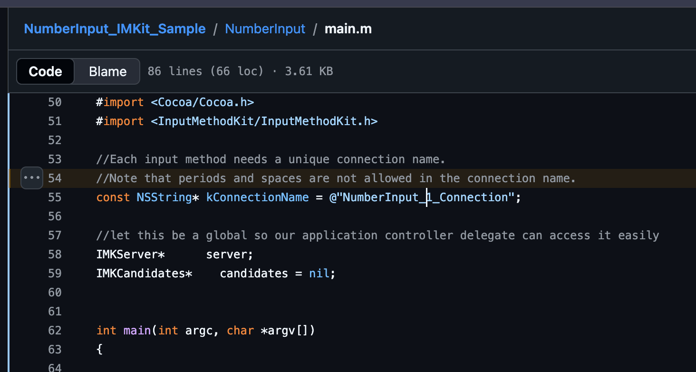
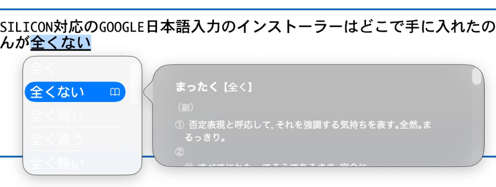
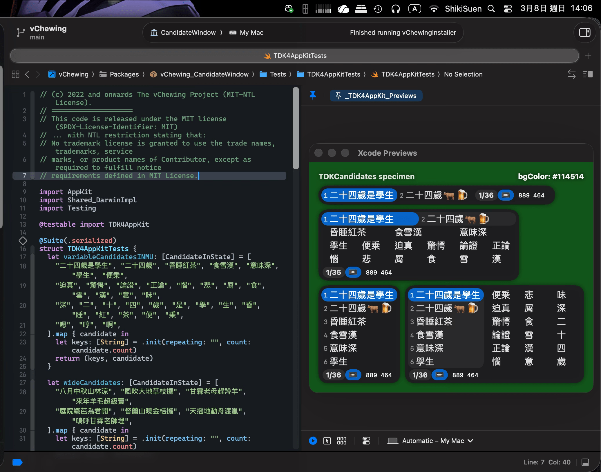

# 寫在2026年的macOS輸入法開發規範

InputMethodKit 自 macOS 10.5 Leopard 時代問世，早於 Objective-C ARC 技術、XPC 通訊技術、Sandbox 技術問世（均為 macOS 10.7）之前。自然，這也是早於 Swift 5 與 SwiftUI 流行之前。也就是說，InputMethodKit 是橫跨了兩代技術大變革的祖產級 OS Framework。當年 Apple 寫給 macOS 10.5 Leopard 的 IMK 參考手冊《[Input Method Kit Framework Reference](https://leopard-adc.pepas.com/documentation/Cocoa/Reference/InputMethodKitFrameworkRef/InputMethodKitFrameworkRef.pdf)》（下文簡稱《IMKFR》）早已不符合這些變革所帶來的新要求（特別是 Swift 6 Concurrency）。筆者根據自己開發[《唯音輸入法》(for macOS 10.09 Mavericks ~ macOS 27)](https://vchewing.github.io/)的經驗，將一些注意事項整理在此，留給其他想給 macOS 開發輸入法的工程師們參考。

> 筆者另外製作了 [IMKSwift](https://github.com/vChewing/IMKSwift) 套件，允許 Swift 工程師們在寫 IMK 輸入法時更順利：IMKSwift 提供了 IMKInputSessionController 基礎型別、是在 IMKInputController 的基礎上整體換用了對 Modern Swift Concurrency 更友好的 ObjC Header 表達。該套件另已內建 §5 所述的 MRC 私有面層；下文 §5 的實作細節可以當作參考實作，而非待辦清單。

## 1. NSConnection 名稱

《IMKFR》沒提及，但正確答案只有一個：輸入法的 `Info.plist` 的 `InputMethodConnectionName` 欄位只能填寫 `$(PRODUCT_BUNDLE_IDENTIFIER)_Connection`。

> ⚠️ **這是 macOS 10.7 Lion 開始對 NSConnection 的命名規範**。
>
> 不按照這個規範命名的話，你的輸入法在開啟 Sandbox 之後，可能就會在使用者嘗試切換到該輸入法的時候無法正常載入。此時可以在 `Console.app` 內觀測到與 NSConnection 有關的失敗訊息。

當年由 Apple 同步提供的「NumberInput」這個範例專案就給了[錯誤示範](https://github.com/pkamb/NumberInput_IMKit_Sample/blob/6c37ea05d85d0b7b5af9378a0ce88e191ca07241/NumberInput/main.m#L53-L55)，誤導了全球的 macOS 輸入法開發者們。官方誤導，最為致命。



Apple 甚至都不得不給那些沒開 Sandbox 的輸入法們開小灶、允許它們在使用非正規命名的 NSConnection 名稱的前提下繼續正常工作。但這被某些輸入法開發者們錯誤地視為「Sandbox 開了反而會壞事」。

## 2. Sandbox Entitlements

一定要開 Sandbox。macOS 輸入法只要開了 Sandbox，就在**原理上**絕對無法拿到系統全局鍵盤權限了。**你的輸入法因為系統框架限制的原因，不得不用 NSConnection 這麼脆弱的東西，再不開 Sandbox 的話，就等於北港香爐人人插**。

「Sandbox 支援」對一款 macOS 輸入法而言，堪稱對使用者的最佳的資安投名狀。

> 於是剩下的幾乎都是不敢開 Sandbox 的輸入法了：或有技術難題，或支支吾吾。

Sandbox 權能檔案的定義如下：

```xml
<?xml version="1.0" encoding="UTF-8"?>
<!DOCTYPE plist PUBLIC "-//Apple//DTD PLIST 1.0//EN" "http://www.apple.com/DTDs/PropertyList-1.0.dtd">
<plist version="1.0">
<dict>
  <key>com.apple.security.app-sandbox</key>
  <true/>
  <key>com.apple.security.files.bookmarks.app-scope</key>
  <true/>
  <key>com.apple.security.files.user-selected.read-write</key>
  <true/>
  <key>com.apple.security.network.client</key>
  <true/>
  <key>com.apple.security.temporary-exception.files.home-relative-path.read-write</key>
  <array>
    <string>/Library/Preferences/$(PRODUCT_BUNDLE_IDENTIFIER).plist</string>
  </array>
  <key>com.apple.security.temporary-exception.mach-register.global-name</key>
  <string>$(PRODUCT_BUNDLE_IDENTIFIER)_Connection</string>
  <key>com.apple.security.temporary-exception.shared-preference.read-only</key>
  <string>$(PRODUCT_BUNDLE_IDENTIFIER)</string>
</dict>
</plist>
```

可以看到這裡將輸入法自身的 UserDefaults 拉入白名單了。這是必需的，因為 macOS 的輸入法做了 Sandbox 處理之後確實會喪失對自身 UserDefaults 的存取能力。

## 3. MainActor 約束與 Swift 6.2+

整個 IMKInputController 所有 API 交互都是走 MainActor 的。但是，InputMethodKit 曝露出來的 Header 與 Swift Concurrency 不相容，導致你在使用時反而無法將 IMKInputController 釘死在 MainActor 上。

讓 InputMethodKit 與 Swift 6 Concurrency 相容性最佳的處理方法就是將整個 target 的 default isolation 設為 MainActor。這樣雖然也難免需要對 IMKInputController 的 API 呼叫處理過程實施一些硬 Hack，但這算是相對而言工作量最小的。

你先引入這兩個 extension API：

```swift
extension IMKInputController {
  nonisolated fileprivate func wrap(_ object: Any?) -> UInt? {
    guard let object = object as? AnyObject else { return nil }
    return UInt(bitPattern: Unmanaged.passUnretained(object).toOpaque())
  }

  nonisolated fileprivate func unwrap(_ addr: UInt?) -> Any? {
    guard let addr = addr, let ptr = UnsafeMutableRawPointer(bitPattern: addr) else { return nil }
    return Unmanaged<AnyObject>.fromOpaque(ptr).takeUnretainedValue()
  }
}
```

再使用這個 MainSync API（有經過處理，防止俄羅斯套娃 DeadLock）：
```swift
@discardableResult
public func mainSync<T>(execute work: @MainActor () throws -> T) rethrows -> T {
  if Thread.isMainThread {
    return try work()
  }
  return try DispatchQueue.main.sync(execute: work)
}
```

然後，這是範本，專門示範怎樣將 API 的參數翻譯到 MainActor 上：
```swift
/// nonisolated 是 IMKStateSetting & IMKMouseHandling 協定要求的。
/// 或者說，官方沒要求，但是是 Swift 相容性沒做好導致的現狀。
@objc(MyIMKInputController) // 必須加上 ObjC，因為 IMK 是用 ObjC 寫的。
nonisolated public final class MyIMKInputController: IMKInputController, @unchecked Sendable {

  @objc(handleEvent:client:)
  nonisolated override public func handle(
    _ event: NSEvent?,
    client sender: Any?
  )
    -> Bool {
    let eventRef = wrap(event)
    let senderRef = wrap(sender)
    return mainSync {
      let clientOnMain = unwrap(senderRef)
      let eventOnMain = unwrap(eventRef)
      // 此處存放業務邏輯。
    }
  }
}
```

可能有人注意到筆者將 `MyIMKInputController` 定義為 Sendable 了。不然 mainSync 無效。

## 4. IMKInputController 該脫手的任務一定要脫手

有些輸入法難免會在 activateServer 階段引入與 client() 有關的交互，但這個開銷可能在所難免，因為你可能必須得對 client 使用 `client.overrideKeyboard()` 套用指定的 Ukelele 佈局。再加上 client() 身為 IMKTextInput Client 沒有真正意義上的 Async API，輸入法開發者只能假設所有這類 Client 的這些操作都是 MainActor 阻塞操作，然後乾瞪眼。

於是乎，除了 `client()?.setMarkedText` 與 `client()?.insertText` 以外，其餘的 client methods 應該是都可以在 MainActor 上面 Async 脫手操作的。只要你嚴格按照前文所述將 IMKInputController 所有 API 交互都釘死在 MainActor 上，你就不用擔心脫手操作所帶來的亂序的問題。

> 注意：`client()?` 是 MainActor 限定物件。你脫手可以，但脫手操作的 Lambda Expression 在呼叫 client() 方法時必須在 MainActor 上。

## 5. IMKInputController 必須是 MRC 管理，且客體綁定必須逐事件重建

### 5.1 IMKServer 控制器洩漏缺陷（逆向工程結論）

筆者針對 InputMethodKit 在 macOS 10.9 Mavericks、10.15 Catalina 與 macOS 27 GoldenGate（arm64e）上做了大量逆向工程，發現 IMKServer 在控制器生命週期管理上有一個根本缺陷：

1. IMKServer 內部以 `_private._controllers` 這個 `NSMutableDictionary` 追蹤所有 `IMKInputController` 實例，鍵是 `[NSNumber numberWithUnsignedLong:clientProxyAddr]`——也就是每枚控制器在 `init` 時所收到的客體代理物件之位址。

2. **每一次 CapsLock 切換都會產生一個全新的 DO/XPC 代理物件**，位址不同。舊控制器在字典裡的鍵從此再也查不到，因為 IMKServer 內建的控制器重用邏輯是以業已改變的代理位址為鍵。舊控制器就此成為永久的孤兒。

3. IMKServer 有 `sessionFinished:` 可以清理某個 App 累積下來的控制器，但 `sessionFinished:` 是按客體代理逐一派發的。CapsLock 一切，舊代理已被替換，IMKServer 不會再對它發任何訊息，於是孤兒控制器永遠收不到 `sessionFinished:`。**每切一次 CapsLock，就漏掉一枚控制器。**

4. 孤兒控制器持有客體連線包裝物件（macOS ≤ 10.15 為 `IPMDServerClientWrapper`；macOS 15 Sequoia 起拆為 `_IPMDServerClientWrapperModern` 與 `_IPMDServerClientWrapperLegacy`），其內又持有 `_xpcConnection`（NSXPCConnection）或 `_clientDOProxy`——這些連線資源同樣永久洩漏。IMK 以全域快取管理這些包裝物件，只能透過私有的類別方法（`+terminateForClientXPCConn:`、`+terminateForClientDOProxy:`）移除。

5. macOS 15 Sequoia 起，無後綴的 `+terminateForClient:` 已被完全移除，只剩 XPC 與 DO 兩個變體。

6. 在 ARC 之下，頻繁 CapsLock 切換造成的 retain/release churn 會導致可感知的卡頓。關閉 ARC（`-fno-objc-arc`）可以完全消除卡頓，但從此孤兒控制器的清理與殘餘 XPC 連線的拆除，都得自己來。

7. **孤兒不只是被漏掉——它還保留著退場當時的客體綁定。** 框架裡沒有任何東西會再更新那個綁定，因為框架裡沒有任何東西還認為這枚控制器在服役。系統此後投給這枚控制器的按鍵，都會以一個已退場客體的身分被回應。

### 5.2 修法：MRC ＋ KVC 剔除 ＋ 位址索引的會話池 ＋ 逐事件認領

**a) IMK 互動層全面改用 MRC。** `IMKInputSessionController` 的 target 以 `-fno-objc-arc` 編譯，控制器的 alloc/dealloc/retain/release 全在 ObjC MRC 層完成。Swift 端只透過原始記憶體位址（`uintptr_t`）與控制器互動，絕不對控制器實例做 Swift ARC 操作。

**b) 以 KVC 剔除孤兒控制器。** 每枚控制器在 init 時取得一個單調遞增的世代號。每當有一枚控制器被建立、並完成自身登記之後，就以 KVC 移除最舊的閒置控制器（世代號最小者，排除當前控制器與新建的這一枚）：`[server valueForKeyPath:@"_private._controllers"] removeObjectForKey:oldKey]`。這讓孤兒控制器在 MRC 下被正常解構。

**c) 以控制器位址為鍵的小型會話池。** 唯音最初以世代奇偶路由會話（偶→會話 A、奇→會話 B，即本文舊版所述的「雙緩衝」）。世代單調遞增，所以奇偶看起來很穩定——而那正是陷阱：兩枚世代同奇偶的控制器會共用同一份會話。第一枚退場時，該會話的客體綁定被清空；第二枚仍繼續透過一份不再認得自己客體的會話派發，於是每一個按鍵都在送達輸入法之前就被丟掉。現行設計改以控制器自身的位址為鍵，會話池至多四份，只有在生命週期追蹤器判定控制器已死時才回收該槽，且絕不做「最近最少使用」式的淘汰。

**d) 延遲拆除，並清理 XPC。** `deactivateServer:` 之後不立即解構控制器，而是啟動一個三秒計時器。計時器觸發時，控制器會：釋放所有 block、對適當的客體包裝類別呼叫私有的 `+terminateForClient*` 類別方法（依 `_IPMDServerClientWrapperModern` → `_IPMDServerClientWrapperLegacy` → `IPMDServerClientWrapper` 的順序回退，以兼容 macOS 27），並清除控制器↔會話的對應。若控制器在三秒內被重新啟用（`activateServer:`），計時器即取消、正常服務。這避免了快速 CapsLock 切換時「舊控制器已死、新控制器還沒準備好」的空窗。

> 延遲拆除買到的是「重用窗口」；它**不**代表控制器已經死了。控制器外殼可能還留在 `_controllers` 裡，直到下一次剔除為止——所以千萬不要把「計時器已觸發」當成存活判據。

**e) 逐事件認領客體。** 每一個送達的事件，在派發之前，會話先把自身重新綁定到「送來這枚事件之控制器」的位址。若值未變則跳過寫入，因此成本是每按一鍵一次比較。就是這一行讓整個設計能自癒：無論系統把事件路由給哪一枚副本，會話的客體永遠是當下正在送事件的那一位。`IMKControllerLifetimeTracker` 仍然守著每一次對原始位址的 `takeUnretainedValue()`。

**f) 以 ObjC runtime 注入輸入法選單。** 輸入法選單由 `IMEMenuSputnik` 動態組建：以 `class_addMethod` ＋ `imp_implementationWithBlock` 把 Swift 閉包直接註冊為 `IMKInputSessionController` 上的方法 IMP，無需曝露 `@objc` selector。選單會注入兩項即時指標：(1) `IMKControllerLifetimeTracker` 追蹤的存活控制器數；(2) 由 `task_vm_info.internal` 取得的匿名私有記憶體用量。每次選單開啟前會呼叫 `purgeMallocZones()` 清空配置器快取，使記憶體讀數反映實際用量。

### 5.3 架構摘要

整體效果是：ARC 徹底退出 IMK 派發路徑，CapsLock 卡頓消失；以位址為鍵的小型會話池取代了極性配對，也就消除了別名共用（aliasing）的隱患；KVC 剔除補上了 IMKServer 無力自行清理孤兒的缺口；逐事件認領讓「過期的客體綁定」不可能存在；延遲拆除則確保 XPC 連線被正常終止，而不是洩漏。

以下是控制器側架構的最小示意：

```swift
// IMKInputSessionController（以 MRC 編譯的 .m 檔）：
// - 類別層級的 static block 以原始位址把呼叫派發給 Swift。
// - +IMKSwift_configureWithActivatingServer: 等在啟動時設定一次。

// Swift 端：以位址為鍵的會話池
@MainActor
final class SessionPool {
  static let shared = SessionPool(capacity: 4)
  private var slots: [UInt: InputSession] = [:]

  func session(for ctlAddr: UInt) -> InputSession { /* 建立或重用此位址的槽位 */ }
  func reap(using tracker: IMKControllerLifetimeTracker) { /* 收掉控制器已死的槽位 */ }
}

// SessionControllerSputnik 的事件區塊：
// 1. 為送來事件的控制器位址取得（或建立）會話。
// 2. adoptClientAddr(ctlAddr)——以送事件的人為準。
// 3. 派發進該會話的核心。
```

> **註：** 會話池以**控制器**位址為鍵，不是客體位址。控制器才是框架真正管理生命週期的物件；客體只是一個隨時可能在其腳下被替換的代理。四個槽位足夠，因為系統同時最多只會有一枚現役控制器，外加一小截正在退場的尾巴。

### 5.4 可觀測性與 kill switch

這些東西沒法用斷點偵錯。你能做的是給它裝上觀測點，並且讓每一項干涉都能被單獨關掉。

**日誌詞彙。** ObjC 層只吐一組固定的詞彙：`ControllerInit:`、`Prune:`（`controllers=`、`current=`、`self=`、`evicted … remaining=`）、`ActivateServer:`（含 `clientTerminatedBefore=`）、`DeactivateServer:`、`DelayedDealloc:`（排定／跳過／執行）、`EventEntry:`（`addr`、`alive`、`gen`、`session=`，以及快取下來的客體名稱）、`guard fail:`（`hasHandler`、`hasClient`、`proxyNil`）。macOS 26 起走 `Logger(subsystem: "vChewing", category: "Log")`，更早的系統回退到 `NSLog`；另有偵錯模式旗標可整體關閉。

**四枚僅供診斷的開關**，見於「開發道場」面板，亦可用原始 `UserDefaults` 鍵設定：

| 開關 | 停用什麼 |
|---|---|
| `configureServerControllerPruningDisabled(_:)` | KVC 剔除 |
| `configureEvictedClientInvalidationDisabled(_:)` | 對被剔除控制器的客體條目作失效處理（只關掉淘汰行為中較激進的那一半） |
| `configureClientWrapperTerminationDisabled(_:)` | 對包裝物件呼叫 `+terminateForClient*`，但保留 dealloc 簿記 |
| `configureControllerDelayedDeallocationDisabled(_:)` | 整個延遲拆除 |

每一個 block 都是在「決策當下」求值、且從不快取；唯音以四個 `_IMKSwift_disable…` 偏好設定餵給它們，所以執行中行程的開關狀態可以即時改變，無需重編。

十六種原始組合，九種可分辨的行為：延遲拆除一關，客體終止與客體失效這兩個開關在同一序列裡就不可達；而剔除一關，客體失效的開關也就無意義了。加這些開關的理由很單純：讓現場回報可以被二分，而不是只能猜。

**三種故障簽名**，這些詞彙能幫你分辨：

1. 失靈時段完全沒有 `EventEntry:` ⇒ 事件從未送達；
2. 有 `EventEntry:` 但 `alive=false`，或出現 `UnresolvableController:` ⇒ 位址弄丟了；
3. 有 `EventEntry:` 且 `alive=true`，但 `session=` 指向另一個客體，或 `assigned=nil` ⇒ 事件送給了錯的客體。

**安裝器。** 請在套件本體替換**之後**再抓取行程 PID，依序 `SIGTERM` → `SIGKILL`、輪詢確認已空、再驗證。不要 `killall` 了事，也不要在替換之前就殺（IMK 會從已註冊的套件按需重啟輸入法，替換前殺只是讓舊程式碼以新 PID 回來）。以 root 身分執行時，請以 `/usr/bin/stat -f%Su /dev/console` 把終止範圍限制在當前主控使用者。

## 6. 將輸入法所有程式內容寫成 Swift Package Library

macOS 的輸入法無法用 breakpoint 等方式偵錯，因為會無限凍結任何沾過你的輸入法的 clients，進而凍結你的整個桌面，最終得依賴外部 SSH 連到你的電腦上殺掉輸入法執行緒才行。你需要自己寫單元測試搭配自己寫的 mockup client 來測試。這樣的話，將輸入法的所有業務內容寫成 Library 會更便於這種偵錯，還能允許開發者靈活地指定專用的 UserDefaults 容器來實現封閉測試。更甚者，你還可以寫個標準的 AppKit App 模擬這個單元測試打字過程，然後用 Instruments 監測是否有記憶體洩漏。這遠比僅保留一個輸入法本體 Xcode Target 要靈活得多。

## 7. 記憶體佔用量自查自糾，必要時自盡以釋放記憶體

使用者電腦的記憶體空間寸土寸金。雖然 macOS 26 的 AppKit 糟糕的 NSWindow 繪製效率導致一款輸入法平均佔用的運存可能從 80MB 暴漲到 200MB 左右。但筆者在這裡介紹的一個設計應該不壞：讓輸入法每次 activateServer 切換到新的打字會話的時候，檢查輸入法自身佔用的記憶體。如果發現佔用的記憶體的量超過 1024MB 的話，就讓輸入法拋出 NSNotification 使用者通知之後自盡。這個 NSNotification 使用者通知的內容就是告知這個情況，免得使用者以為輸入法崩潰掉。

當然，這個技巧只是兜底策略、防止在使用者的電腦上發生像是「記憶體用盡」這樣的災難性的後果。但開發者仍有義務主動檢查自己寫的東西是否有記憶體洩漏的危險。

> ⚠️ 如果你的輸入法有在用 SQLite 的話，需要額外注意一個冷門常識：用 SQLite 跑完每一筆查詢之後一定要用 `sqlite3_finalize(StatementPointer)` 釋放記憶體，不然會產生**連 Xcode Instruments 都抓不到**的記憶體洩漏。

## 8. 讓輸入法用到的 NSWindow 數量盡可能地少

這一條是針對 macOS 26 開始的現狀而不得已的規範，因為：自 macOS 26 開始，只要是 NSWindow 用過的記憶體空間，就都不會被系統刻意回收掉 NSWindow 每個副本的基礎開銷、且這個基礎開銷因為 LiquidGlass 的原因而非常高昂。哪怕你確實沒啟用 LiquidGlass 效果，也沒差。在 Info.plist 當中啟用 `UIDesignRequiresCompatibility` 雖然可以讓記憶體佔用量下降到 macOS 15 的水準，但這只是緩兵之計、且 Apple 隨時都會廢掉 `UIDesignRequiresCompatibility` 這個 InfoPlist 屬性。

> 筆者推測：macOS 26 佔用硬碟空間這麼大，很可能是系統卷宗裡面包了一個 macOS 15 AppKit 環境、專門用來對這個 InfoPlist 屬性提供 backward compatibility。

現在 SwiftUI 這麼強了，開發者完全可以考慮將「工具提示 Panel」與「自己搓的選字窗」整合到同一個 NSPanel 裡面，這樣就少了一份 NSWindow 基礎開銷。輸入法的「關於」視窗也可以整入輸入法自身的「偏好設定」裡面。

> NSPanel 是 NSWindow 的變種。

## 9. IMKCandidates 不要用就對了

前文提到的那個 NumberInput 範例都不敢用 IMKCandidates 選字窗，因為 IMKCandidates 就是一包陳年糞便、臭到現在。你看 macOS 26 系統內建的日語輸入法就是 IMKCandidates 的受害者，連文字都看不清：



玻璃背景居然全透明了、把白色整個透上來。偏偏選字窗的文字也是白色的。這種問題一眼看出來就是缺乏單元測試惹的禍，因為這很明顯就是 Liquid Glass API 沒正確使用所導致的。

現在 AI 技術這麼發達，你用 AI 幫你寫一個類似 IMKCandidates 那種佈局的輸入法選字窗面板應該也不難。當然，如果你用強行曝露 IMKCandidates 內部 API 的方式來使用的話，有些 API 從 macOS 10.14 Mojave 開始是固定可用的，但將來就不好說了。

> 筆者給自己開發的唯音輸入法就使用了自己搓的田所選字窗，與 IMK 多行選字窗相比也算提供了比較迫真的體驗。



## 結尾

InputMethodKit 是歷史產物，但它至今仍是 macOS 輸入法唯一的官方入口。既然如此，開發者就必須接受這套框架的歷史包袱，並在其結構性缺陷之上建立自己的工程紀律。

本文所列規範，本質上並非「技巧」，而是一套風險控制模型：將 IMKInputController 變為純轉接層、將業務邏輯完全模組化、將 MainActor 當作不可違抗的事實、將記憶體壓力視為設計輸入條件、將 Sandbox 視為最低限度的道德底線。

若有一天 Apple 徹底重寫 InputMethodKit，這些規範或許會過時；但在那之前，macOS 輸入法若想在 2026 年仍保持工程品質與資安可信度，就必須把「自我約束」寫進架構，而不是寫在 README 裡。

$ EOF.
